# Walkthrough of the operator's main flows

This walks the operator's main flows on the admin page step by step. Each step
links to the frame that draws it. The frames are in `images/`. Every frame has
its id in its top left and a note under the screen with the exact copy and the
rules.

The operator is the host, signed in with the admin token. All people, hosts
and keys are sample data: `signalhub.example`, Rodrigo (admin), Ana (mod), Rui
(basic).

Contents:

1. [Sign in](#1-sign-in)
2. [Check Status](#2-check-status)
3. [Find a failing push and its device](#3-find-a-failing-push-and-its-device)
4. [Connect a device](#4-connect-a-device)
5. [Invite a user and set a role](#5-invite-a-user-and-set-a-role)
6. [Create a producer and issue a key](#6-create-a-producer-and-issue-a-key)
7. [Disable a producer](#7-disable-a-producer)
8. [Delete old events by rule](#8-delete-old-events-by-rule)
9. [The users' web page: New producer](#9-the-users-web-page-new-producer)
10. [The choices and their alternatives](#10-the-choices-and-their-alternatives)
11. [What the server must provide](#11-what-the-server-must-provide)
12. [What was left out](#12-what-was-left-out)

## 1. Sign in

The page has no accounts and no passwords. The operator pastes the admin token
(`SIGNALHUB_ADMIN_TOKEN` from the server's `.env`). The screen has no rail.

1. **The first screen.** One field, a 48 px show and hide toggle, one button.
   Sign in stays off until the token has 32 characters. The screen says the page
   is served on the server's own port only, and that the token stays in this page
   only (its memory, never the browser's storage or a cookie), so reloading
   asks again. 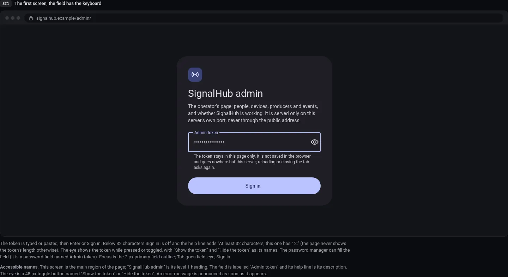
2. **Signing in.** The button waits for the server. [SI5](images/status-sign-in/si5-signing-in-waiting-for-the-server.webp)
3. **When it fails.** Each failure says what happened and what to do.
   - Wrong token (the server answered 401): [SI2](images/status-sign-in/si2-wrong-token-the-server-answered-401.webp)
   - The management API is off (404), with the three steps to turn it on: [SI3](images/status-sign-in/si3-the-management-api-is-off-the.webp)
   - The server cannot be reached: [SI4](images/status-sign-in/si4-the-server-cannot-be-reached.webp)
4. **Account menu and signing out.** The avatar at the foot of the rail opens a
   menu with the version and Sign out. A dialog confirms. There was no way to
   forget the token before. [M1](images/shell-producers/m1-the-account-menu-option-a.webp), [M2](images/shell-producers/m2-sign-out-confirmed.webp). After it the sign-in
   screen says so: [SI6](images/status-sign-in/si6-signed-out-after-the-signout-dialog.webp)
5. **A lost session.** If the token stops working in use, the page returns to
   sign-in and keeps the section in the address: [SI7](images/status-sign-in/si7-the-session-was-lost-the-token.webp)
6. **On a phone**: [PS1](images/status-sign-in/ps1-phone-the-first-screen.webp), [PS2](images/status-sign-in/ps2-phone-wrong-token.webp), [PS3](images/status-sign-in/ps3-phone-the-management-api-is-off.webp), [PS4](images/status-sign-in/ps4-phone-the-session-was-lost.webp)
7. **Light**: [LI1](images/light-theme/li1-sign-in-si1-the-first-screen.webp)

## 2. Check Status

Status answers "is SignalHub working?" in its first line, in words and an icon.
It is one column of answers with no list and no pane. Nothing on it can be
changed (settings live in the server's `.env` and need a restart), and it says
so. It reads `/q/info`, `/q/health`, `/api/v1/admin/status`, the device list and
the newest event, and looks again every 30 seconds.

1. **The rail button.** From any section, the button at the foot of the rail
   says Working, Check, Checking or Unknown, by icon and word. 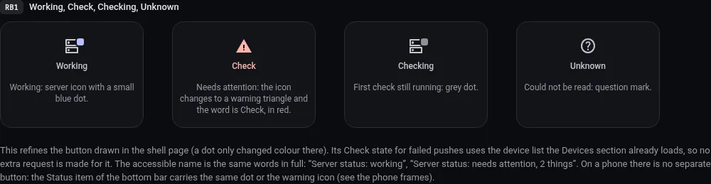
2. **Working.** The parts in plain language, each with a value and what to do if
   it goes wrong. 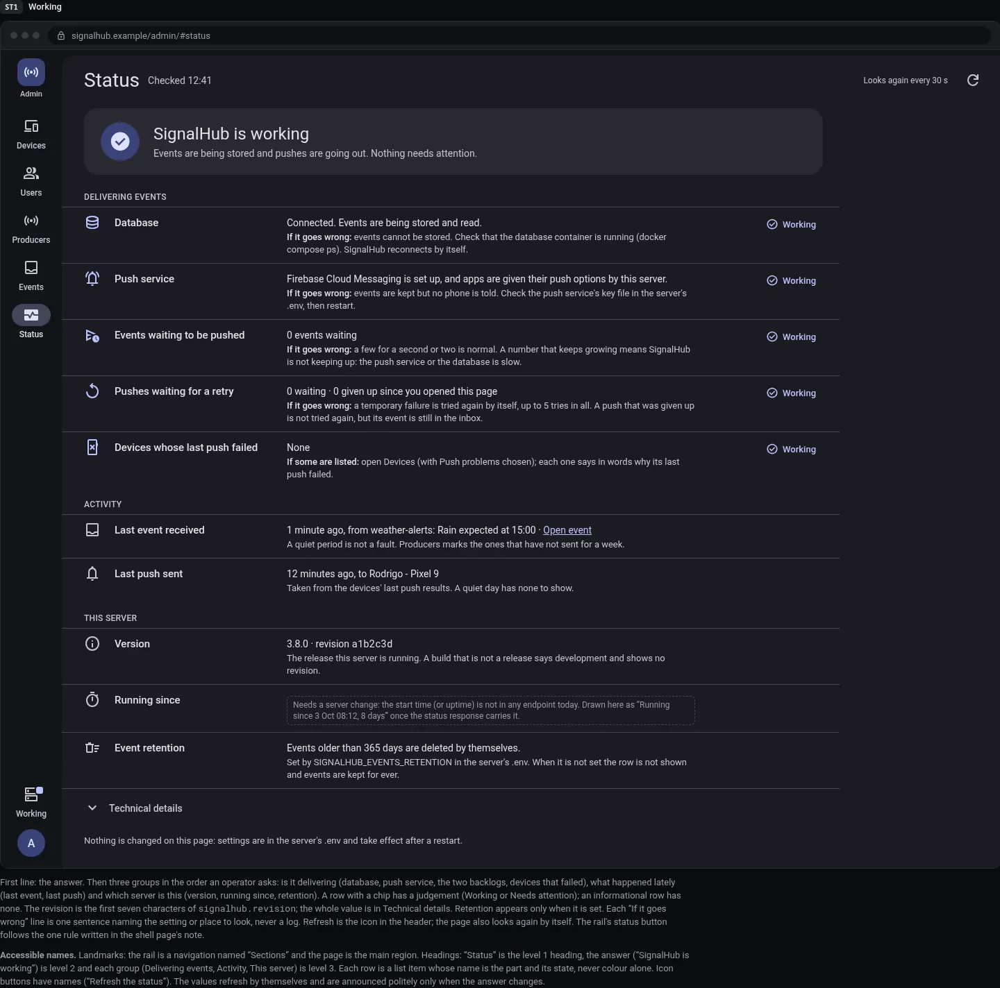
3. **Needs attention.** The problem rows move to the top under their own
   heading, with an error edge, the words Needs attention and a warning icon.
   Here the push service is failing: every device with a push address failed its
   last push, and retries are being given up. 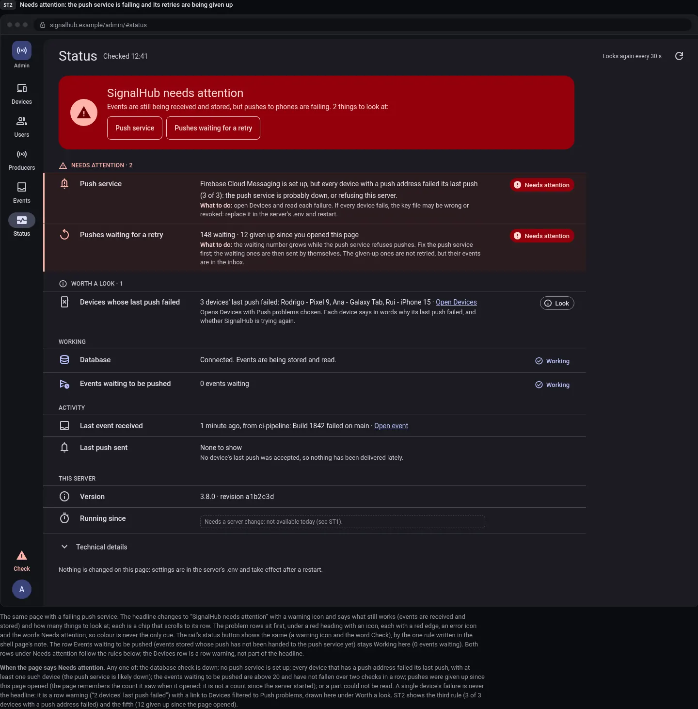
4. **Other rows that need a look**: database down, push not set up, events
   waiting to be pushed, a part that could not be read, a development build.
   [ST3](images/status-sign-in/st3-other-rows-that-need-a-look.webp)
5. **Technical details.** Raw check names, values and endpoints, with Copy.
   [ST4](images/status-sign-in/st4-technical-details-open-the-page-scrolled.webp)
6. **Loading and failing.** [ST5](images/status-sign-in/st5-loading-the-first-time-the-page.webp), [ST6](images/status-sign-in/st6-the-status-could-not-be-read.webp)
7. **On a phone**: [PT1](images/status-sign-in/pt1-phone-working-one-row-opened.webp), [PT2](images/status-sign-in/pt2-phone-needs-attention.webp), [PT3](images/status-sign-in/pt3-phone-could-not-be-read.webp). The bottom bar's Status item
   carries the dot or the warning icon.
8. **Light**: [LS1](images/light-theme/ls1-status-st1-signalhub-is-working.webp), [LS2](images/light-theme/ls2-status-st2-needs-attention.webp)

The "needs attention" rules are in [DESIGN.md 9.5](../users/DESIGN.md#95-status-when-signalhub-needs-attention).

## 3. Find a failing push and its device

Ana says a build alert never reached her tablet. The operator starts from a
failed push and ends at a device.

1. **From Status.** The Devices row under "Worth a look" links to Devices
   filtered to Push problems. [ST2](images/status-sign-in/st2-needs-attention-the-push-service-is.webp)
2. **From Events.** The Events list is newest first, 25 at a time, with filter
   chips: Read state, Severity, Push problems, Producer, Category, User and
   Received. An event with a failed or given-up push carries a Push problems
   marker. 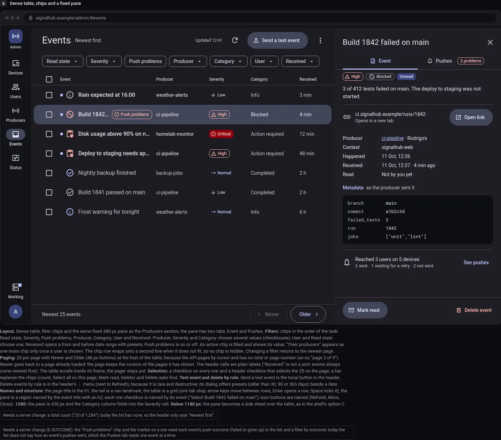
3. **Filter.** Severity takes several values: [S4](images/events/s4-a-filter-chip-open-severity-several.webp). Received takes a
   from and a before date: [S4b](images/events/s4b-the-received-chip-open-a-date.webp). A filtered list: [S5](images/events/s5-filtered-severity-critical-and-unread-only.webp)
4. **Open the event.** The pane has two tabs. Event shows what was sent.
   [E1](images/events/e1-the-event-tab-what-was-sent.webp)
5. **Pushes.** Grouped by user (the producer's owner and every subscriber), one
   line per device, in plain words: Sent, Waiting for a retry (while attempts
   remain, at most 5), Failed with the reason, Gave up after 5 tries, and Not sent
   with why. Nothing is shown by colour alone. 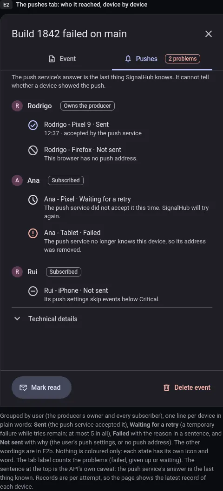
6. **The other wordings** (Refused, Not supported, paused, muted, gave up):
   [E2b](images/events/e2b-the-pushes-tab-the-other-wordings.webp). **Technical details** hold the codes: [E3](images/events/e3-the-pushes-tab-with-technical-details.webp)
7. **Nobody to reach, and a failed load**: [E4](images/events/e4-pushes-tab-nobody-to-reach-and.webp), [E5](images/events/e5-pushes-tab-the-list-could-not.webp)
8. **The device.** On Devices, a device with a push problem says what is wrong in
   words, with the last push result under Technical details. [DV1](images/devices/dv1-list-with-a-device-selected.webp), [DV2](images/devices/dv2-a-push-problem-technical-details-open.webp)
9. **Listing states**: [DS1](images/devices/ds1-loading.webp), [DS2](images/devices/ds2-empty-no-device-yet.webp), [DS3](images/devices/ds3-no-match-for-the-search-or.webp), [DS4](images/devices/ds4-refresh-failed-banner-over-the-older.webp), [DS5](images/devices/ds5-success-a-snack-bar-and-the.webp), [DS6](images/devices/ds6-keyboard-focus.webp)
10. **On a phone**: [Q1](images/events/q1-phone-the-list.webp), [Q2](images/events/q2-phone-the-detail-full-screen.webp), [Q3](images/events/q3-phone-send-a-test-event-a.webp), [Q4](images/events/q4-phone-the-filters-sheet.webp), [PD1](images/devices/pd1-the-list.webp), [PD2](images/devices/pd2-the-detail-full-screen.webp)

## 4. Connect a device

1. **Devices.** Every device and every signed-in browser is a row: name, tags
   (Admin device on a device only, Browser, Revoked), user, last activity and how
   its push is going. A signed-in browser: [DV3](images/devices/dv3-a-signedin-browser.webp)
2. **Connect a device** is a tonal header button. It makes a one-time pairing
   code. It asks for the device's name (up to 100 characters) and the user it
   belongs to, written "Name · Role". Revoked users are not offered. 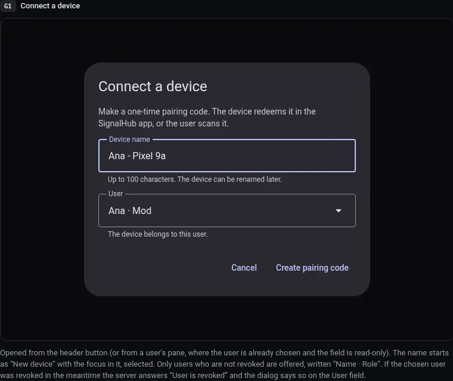, [G1b](images/devices/g1b-connect-the-admindevice-sentence.webp)
3. **The pairing code.** A QR, a link to copy and a countdown, and a line that
   waits for the device. 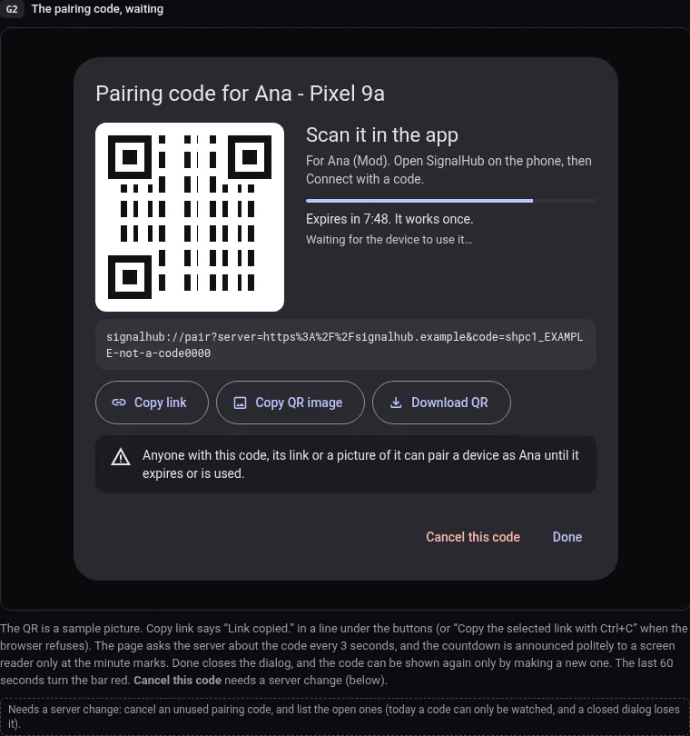
   - With no `SIGNALHUB_PUBLIC_URL` set the server answers a code but no link,
     so the dialog shows the code alone and the sentence on setting it: [G1c](images/devices/g1c-the-code-without-a-link-no.webp)
   - Expired: [G3](images/devices/g3-the-code-expired.webp)
   - Used. The dialog says which device used it: [G4](images/devices/g4-the-code-was-used.webp)
4. **Rename**: [G5](images/devices/g5-rename.webp). Device names are not unique.
5. **Revoke.** The device stops working and stays listed. Nobody is told:
   changes made on the admin page send no push. [G6](images/devices/g6-revoke-an-admin-device.webp), and if it did not
   work: [G6b](images/devices/g6b-revoke-it-did-not-work.webp)
6. **Delete**, only for a revoked device: [DV4](images/devices/dv4-a-revoked-device-delete-is-offered.webp), [G7](images/devices/g7-delete-a-revoked-device.webp)
7. **On a phone**: [PD3](images/devices/pd3-the-pairing-code-full-screen.webp), [PG1](images/devices/pg1-connect-a-device-full-screen.webp), [PG2](images/devices/pg2-revoke-as-a-bottom-sheet.webp), [PG3](images/devices/pg3-the-code-was-used.webp)
8. **Light**: [LG1](images/light-theme/lg1-the-pairing-code-dialog-g2.webp)

## 5. Invite a user and set a role

1. **Users.** One row per user: name, role tag, devices, producers,
   subscriptions and when they were last active (the newest of their devices).
   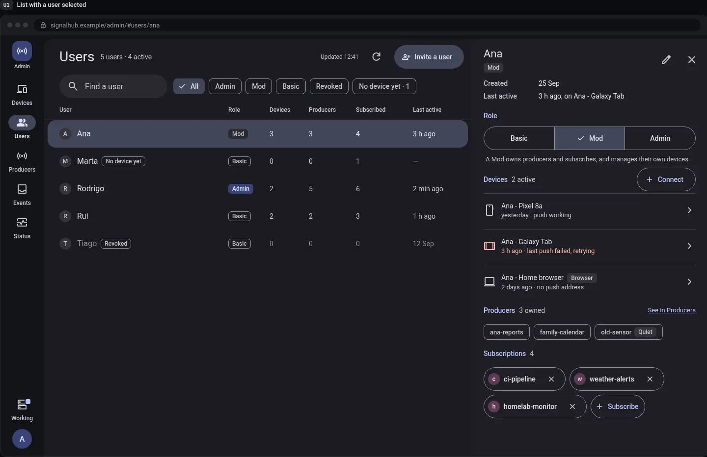
2. **Invite a user** is a tonal header button. The role is chosen here: Basic,
   Mod or Admin. 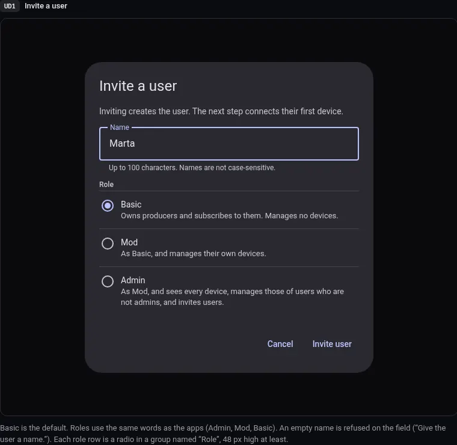
   - Admin chosen, with its warning: [UD1b](images/users/ud1b-invite-admin-chosen.webp)
   - The name is taken (names are unique, ignoring case): [UD1c](images/users/ud1c-invite-that-name-is-taken-409.webp)
   - It did not work: [UD3](images/users/ud3-invite-it-did-not-work.webp)
3. **Step 2: connect their first device**, with a pairing code: [UD2](images/users/ud2-step-2-connect-their-first-device.webp).
   Until then the user has no device: [U3](images/users/u3-invited-no-device-yet.webp)
4. **Set a role.** A Basic, Mod or Admin choice with one sentence on what each
   can do. Each change is confirmed, because someone else is affected.
   - Make a user a Mod: [UC1](images/users/uc1-make-a-user-a-mod.webp)
   - Make a user an Admin: [UC2](images/users/uc2-make-a-user-an-admin.webp)
   - Take Admin away. The server has no last-admin guard, so the dialog warns
     rather than refuses: "Nobody will be an admin in the app. The admin token
     still works here." [UC3](images/users/uc3-take-admin-away-the-last-admin.webp)
   - Success and keyboard focus: [US4](images/users/us4-success-role-changed-and-keyboard-focus.webp)
5. **The rest of the pane**: devices, producers, subscriptions, recent traffic
   with a link to Events filtered to that user. [U2](images/users/u2-the-same-pane-scrolled-down.webp), [U4](images/users/u4-an-admin-and-a-revoked-user.webp)
   - Subscribe, and its choice of producer: [UC5](images/users/uc5-subscribe-the-choice-of-producer.webp)
   - Unsubscribe hides all of that producer's events from the user, old ones
     too. They come back on subscribing again: [UC4](images/users/uc4-unsubscribe.webp)
6. **Rename and revoke.** A revoked user keeps their name, so the name stays
   taken, and subscribers lose that user's producers. [UC7](images/users/uc7-rename-a-user.webp), [UC7b](images/users/uc7b-rename-that-name-is-taken-409.webp), [UC6](images/users/uc6-revoke-a-user.webp)
7. **States**: [US1](images/users/us1-loading.webp), [US2](images/users/us2-empty-and-no-match.webp), [US3](images/users/us3-refresh-failed-over-the-older-list.webp)
8. **On a phone**: [PU1](images/users/pu1-the-list.webp), [PU2](images/users/pu2-the-detail-full-screen.webp), [PU3](images/users/pu3-invite-a-user-full-screen.webp), [PC1](images/users/pc1-a-role-change-as-a-sheet.webp), [PC2](images/users/pc2-subscribe-as-a-sheet.webp), [PC3](images/users/pc3-invited-connect-the-first-device.webp)

## 6. Create a producer and issue a key

1. **Producers** is the whole inventory with a search and filter chips. A
   selected row opens its detail in the pane. 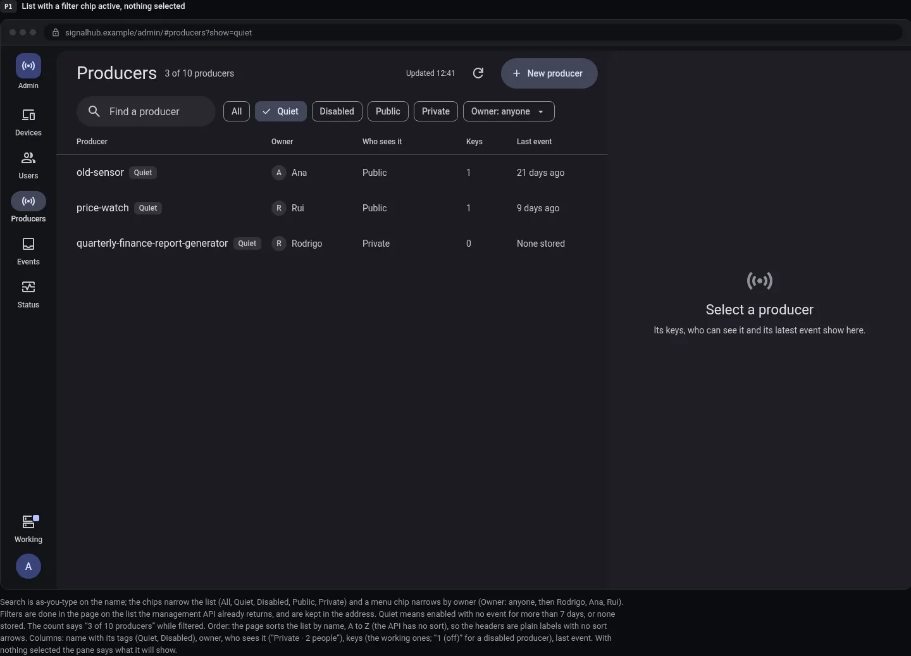
2. **New producer** is a tonal header button and opens a dialog, not a form at
   the bottom of the page. 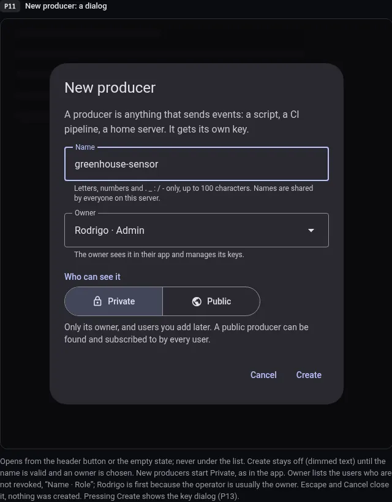. The name is taken: [P12](images/shell-producers/p12-new-producer-the-name-is-taken.webp)
3. **The key, shown once**, in monospace with Copy, and a sentence that it will
   not be shown again. Labels in the list are the prefix and the key's id, such
   as `shpk1_3f1c0b8e5d2a...`. 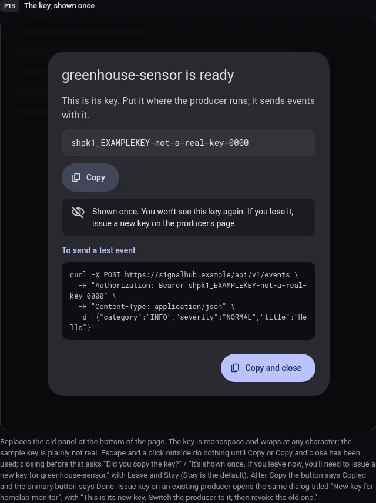
4. **Change something.** The pane confirms in place, and a failure is said in the
   pane. [P8](images/shell-producers/p8-success-a-change-confirmed-in-the.webp), [P9](images/shell-producers/p9-failure-a-change-that-did-not.webp)
5. **Revoke a key.** For good. [P14](images/shell-producers/p14-confirm-revoke-a-key-replaces-the.webp)
6. **Public to private.** Everyone but the owner and the people on the list
   stops being subscribed, and people added later must subscribe again. [P16](images/shell-producers/p16-confirm-public-to-private.webp)
7. **Remove someone from the list**: [P17](images/shell-producers/p17-confirm-remove-someone-from-the-list.webp). Renaming a producer needs a
   server change (S2a): [P12b](images/shell-producers/p12b-rename-producer-the-name-is-taken.webp)
8. **Loading, empty and failing**: [P4](images/shell-producers/p4-loading.webp), [P5](images/shell-producers/p5-empty-no-producer-exists.webp), [P6](images/shell-producers/p6-empty-nothing-matches.webp), [P7](images/shell-producers/p7-the-list-failed-to-load-with.webp). **Focus**: [P10](images/shell-producers/p10-keyboard-focus.webp)
9. **On a phone**: [P18](images/shell-producers/p18-phone-the-list-390-wide.webp), [P19](images/shell-producers/p19-phone-the-detail-full-screen.webp), [P20](images/shell-producers/p20-phone-new-producer-full-screen.webp)
10. **Light**: [LA1](images/light-theme/la1-shell-a-the-producers-list-and.webp), [LA2](images/light-theme/la2-a-disabled-producer-technical-details-open.webp)

## 7. Disable a producer

Disabling turns a producer's senders away until it is enabled. Its events stay.

1. **Disable.** A button in the pane, then a confirmation. [P15](images/shell-producers/p15-confirm-disable-a-producer.webp)
2. **A disabled producer.** The table says Disabled and "1 (off)" for its keys.
   The pane says "1 not working while disabled" and dims its key. Technical
   details are open here. 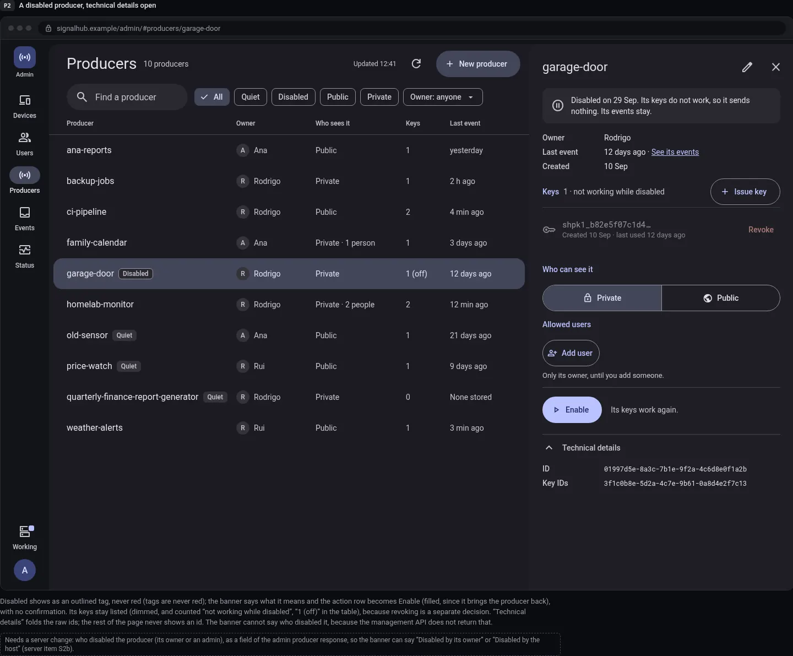
3. **Enable** is a filled button that replaces Disable, with no confirmation: the
   keys work again and nothing is lost. The banner cannot yet say who disabled the
   producer (S2b).
4. **A quiet producer.** No event for a week, with every key revoked: [P3](images/shell-producers/p3-quiet-with-every-key-revoked.webp)

## 8. Delete old events by rule

1. **Events.** [A](images/events/a-dense-table-chips-and-a-fixed.webp)
2. **Send a test event** first, if needed: an event sent as an existing producer,
   stored and pushed as its own. A disabled producer is refused. [D1](images/events/d1-send-a-test-event.webp). A
   link must be http or https. [D2](images/events/d2-send-a-test-event-invalid-metadata.webp). The result: [D2b](images/events/d2b-sent-the-result.webp)
3. **Select rows.** The bulk bar shows the count and Mark read, Mark unread and
   Delete. [S1](images/events/s1-three-events-selected-the-bulk-bar.webp). The confirmation names the count: [S2](images/events/s2-delete-the-selection-the-confirmation.webp). The
   success message has no Undo: [F1](images/events/f1-success-deleted-3-events.webp)
4. **By rule.** The header menu has Delete events by rule. [S3](images/events/s3-the-header-menu-delete-events-by.webp)
5. **The rule dialog** offers presets (older than 30, 90 or 365 days) beside a
   date, with the time zone said. [D6](images/events/d6-delete-by-rule-ready-to-count.webp), nothing chosen: [D3](images/events/d3-delete-by-rule-no-rule-chosen.webp)
6. **Dry run.** Count events first, then confirm with the count in the button.
   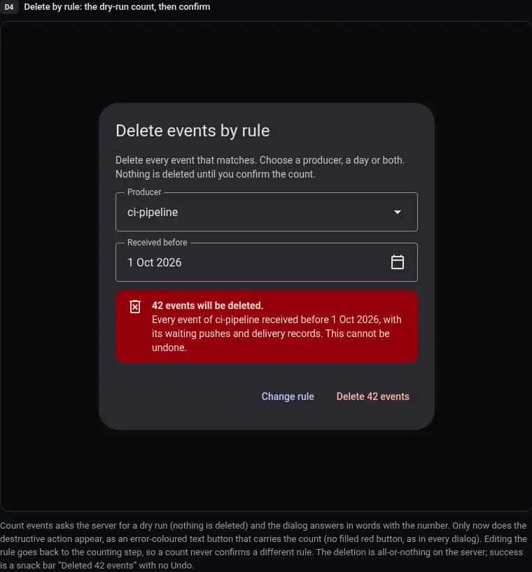. Nothing to delete: [D5](images/events/d5-delete-by-rule-nothing-to-delete.webp)
7. **States and focus**: [L1](images/events/l1-loading-the-first-page.webp), [L2](images/events/l2-empty-no-events-at-all.webp), [L3](images/events/l3-no-match-for-the-filters.webp), [L4](images/events/l4-error-refresh-failed-older-list-kept.webp), [L5](images/events/l5-error-the-first-load-failed.webp), [F2](images/events/f2-keyboard-focus.webp)
8. **Light**: [LE1](images/light-theme/le1-events-a-an-events-detail-pushes.webp)

## 9. The users' web page: New producer

On the users' web page the floating New producer button sat on top of the last
producer. Each option is drawn at 1440 and 390 px with 13 producers, scrolled to
the end, so the last row has to be fully visible.

1. **A, chosen.** A tonal button in the list header, the first tab stop. At 390
   px the title, the button and the avatar fit in one row. 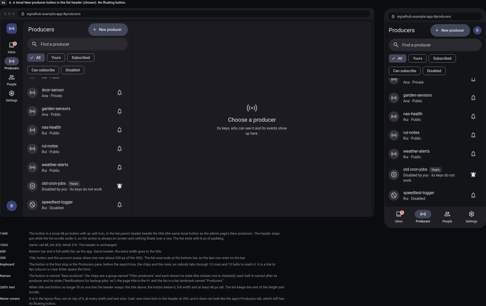
2. **B, not chosen.** The floating button kept, space reserved under the last
   row, and the button shrinks to an icon while scrolling down. [9b](images/web-new-producer/9b-b-keep-the-floating-button-reserve.webp)
3. **C, not chosen.** A dashed card "Send events from something new" at the end of
   the list. [9c](images/web-new-producer/9c-c-a-new-producer-card-at.webp)
4. **Light.** A at 1440 and 390: [9d](images/web-new-producer/9d-option-a-in-the-light-theme.webp)
5. **Chips wrap** on this page and a Disabled chip is added, so the producers
   disabled by their owner or the host, at the bottom of the list, are never hidden.

## 10. The choices and their alternatives

### 10.1 The owner's picks

| Where | Chosen | Why | Not chosen |
| --- | --- | --- | --- |
| Shell | A | The owner's choice. The table and its pane stay side by side. Below 1180 px it uses C's side sheet. | [B](images/shell-producers/b-top-bar-rail-twoline-list-and.webp): a top bar with the rail and a wide two-column detail. [C](images/shell-producers/c-rail-fullwidth-table-and-a-side.webp): a full-width table with a 560 px side sheet over the list. |
| Events | A | Severity, producer and time in aligned columns, so a failure stands out by scanning one column. | [B](images/events/b-grouped-by-day-collapsible-filters.webp): good for catching up, cannot compare rows. [C](images/events/c-facet-sidebar-and-saved-quick-filters.webp): strong for hunting a problem but needs server counts that do not exist. |
| Web New producer | A | It matches the admin header button, is the first tab stop and nothing floats. | [9b](images/web-new-producer/9b-b-keep-the-floating-button-reserve.webp), [9c](images/web-new-producer/9c-c-a-new-producer-card-at.webp) |

### 10.2 The rules decided after review (R1 to R8)

The full text is in [DESIGN.md 9.2](../users/DESIGN.md#92-rules-every-admin-page-follows-r1-to-r8).

- R1: dialog actions are 48 px text buttons, never a filled red button.
- R2: header actions are tonal.
- R3: a snackbar never covers a control and has no Undo (the page confirms).
- R4: every control is 48 px high.
- R5: one set of words (Create, Could not, Revoke, Delete, Disable, Remove, Unsubscribe).
- R6: chip rows wrap, on the admin page and the web page.
- R7: neutral pronouns.
- R8: no sort arrows, since the API has no sort.

### 10.3 Copy that follows what the server really does

- A change made on the admin page (revoke, rename, delete) sends no push.
- Unsubscribing hides all of a producer's events from the user, old ones too.
- The server has no last-admin guard: taking Admin away warns, it does not refuse.
- A revoked user keeps their name.
- A delivery is "Waiting for a retry" only while attempts remain (at most 5).
- Producer, category and severity filters take several values. The Received
  filter has a from and a before date.
- A browser never carries an "Admin device" tag: a browser session cannot manage
  devices.
- A link on an event must be http or https.

## 11. What the server must provide

Everything drawn exists in the management API today except the items below,
each a dashed "Needs a server change" note in a frame. The table, with each
item's size and frames, is in [README.md](README.md#the-server-changes-the-designs-need).

- **S1** list and cancel open pairing codes ([G2](images/devices/g2-the-pairing-code-waiting.webp)).
- **S2a** rename a producer from the admin API ([P12b](images/shell-producers/p12b-rename-producer-the-name-is-taken.webp)).
- **S2b** `disabledBy` on the admin producer response ([P2](images/shell-producers/p2-a-disabled-producer-technical-details-open.webp)).
- **S3** `startedAt` in the status response ([ST1](images/status-sign-in/st1-working.webp)).
- **S7** a `final` marker on delivery records ([E2b](images/events/e2b-the-pushes-tab-the-other-wordings.webp)).
- **S4** a total count for the event list, optional ([A](images/events/a-dense-table-chips-and-a-fixed.webp)).
- **E-OUTCOME** each event's push outcome in the list and a filter by it,
  optional ([S5](images/events/s5-filtered-severity-critical-and-unread-only.webp)).

## 12. What was left out

- A per-user last-active time on the server: the page takes the newest of the
  user's devices.
- Facet counts per producer, severity and category (only option C needed them).
- Per-provider push counters in the status response: "push service failing" is
  read from the devices' last push.
- Single-device and single-user lookups: the lists are small and refresh every 30
  seconds.
- Text search and sorting on the server: search, filters and order are done in the
  page, and Events say "Newest first".
- Undo on the admin page and the web page: the page confirms instead.
- The page's own accounts: the operator signs in with the admin token and nothing
  else.
- Clickable prototypes: the admin drawings are plain frames.
